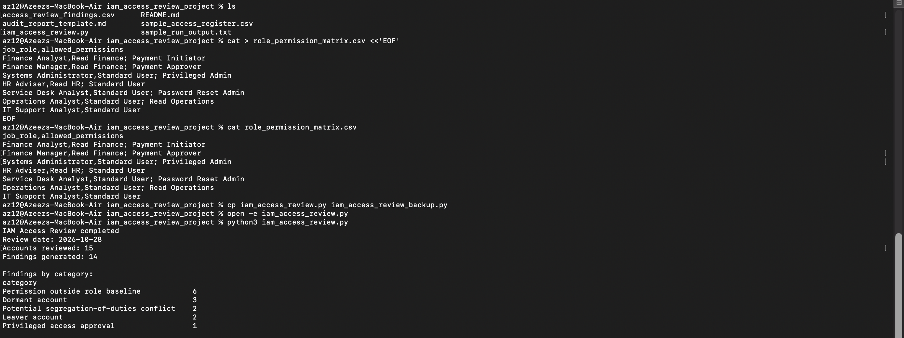

# IAM Access Review and Audit

## Project Overview

This project demonstrates a practical Identity and Access Management (IAM) access review using Python and CSV datasets.

The aim is to identify potential access control weaknesses, excessive permissions and account-related risks through automated checks based on role-based access control (RBAC) principles.

The project uses fictional user data to simulate an access review and produce audit findings with recommended remediation actions.

## Objectives

- Review user access across different departments and job roles.
- Identify permissions that fall outside approved role baselines.
- Detect dormant and leaver accounts.
- Identify potential segregation-of-duties (SoD) conflicts.
- Check whether privileged access has been appropriately approved.
- Generate audit findings to support remediation and access governance.

## Key Controls and Checks

The Python script performs the following checks:

| Control | Description |
|---|---|
| Role-Based Access Control (RBAC) | Identifies permissions that fall outside the defined role permission matrix. |
| Dormant Accounts | Flags accounts with no login activity for more than 90 days. |
| Leaver Accounts | Identifies accounts associated with employees who have left the organisation. |
| Segregation of Duties | Flags accounts with conflicting Payment Initiator and Payment Approver permissions. |
| Privileged Access | Identifies privileged accounts where approval is not recorded. |

## Technologies Used

- Python 3
- CSV datasets
- Visual Studio Code / TextEdit
- GitHub

## Project Files

- `iam_access_review.py` – Python script used to perform the automated access review.
- `sample_access_register.csv` – Fictional user access register.
- `role_permission_matrix.csv` – Defines the approved permissions for each job role.
- `access_review_findings.csv` – Generated audit findings.
- `iam_remediation_tracker.csv` – Tracks identified findings and recommended remediation.
- `audit_report_template.md` – Template for documenting the audit review.
- `sample_run_output.txt` – Example script execution output.
- `iam-access-review-output.png` – Screenshot showing the script execution.

## Results

The latest execution reviewed 15 fictional user accounts and generated 14 findings.

| Finding Category | Findings |
|---|---:|
| Permissions outside role baseline | 6 |
| Dormant accounts | 3 |
| Potential segregation-of-duties conflicts | 2 |
| Leaver accounts | 2 |
| Privileged access approval issues | 1 |
| **Total** | **14** |

The findings include recommended actions to support investigation, access validation and remediation.

## Testing and Validation

The project was tested using synthetic access data.

An additional RBAC test was performed by assigning a permission outside a user's approved role baseline.

**Expected result:** The script identifies the unauthorised permission and generates a corresponding finding.

**Actual result:** The script successfully generated a `Permission outside role baseline` finding.

**Outcome:** Passed.

## How to Run the Project

1. Clone or download this repository.
2. Open the project folder in Terminal.
3. Run the following command:

```bash
python3 iam_access_review.py
```

4. Review the generated `access_review_findings.csv` file.
5. Use the findings and remediation tracker to document follow-up actions.

## Skills Demonstrated

- Identity and Access Management (IAM)
- User Access Reviews
- Role-Based Access Control (RBAC)
- Least Privilege
- Access Governance
- Segregation of Duties (SoD)
- Privileged Access Management
- Audit and Compliance Monitoring
- Python Automation
- Risk Identification and Remediation

## Project Screenshot



## Disclaimer

This project uses entirely fictional data for educational and portfolio purposes. No real user accounts, credentials or organisational information are included.
